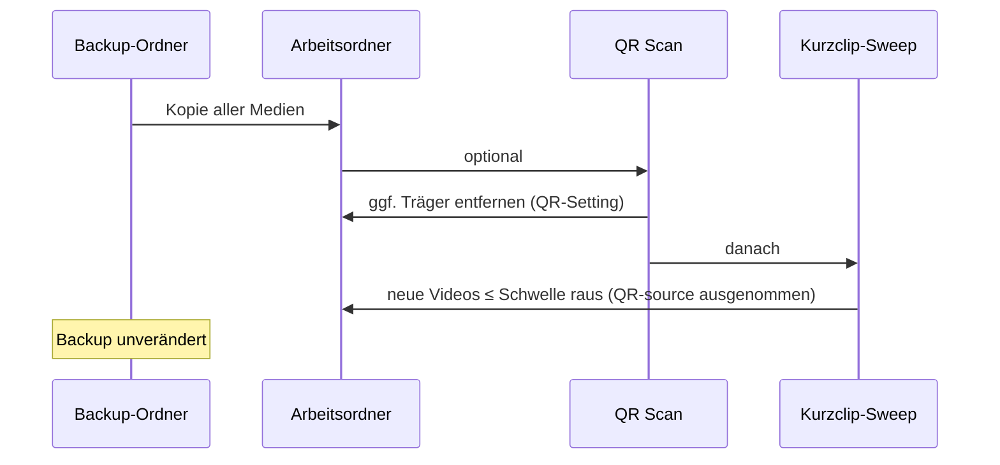

# OPT-29 — Kurzclip-Bereinigung nach Import (+ QR)

> **Agent-Attach:** Diese Datei (nicht `@docs/opt/ARCHIVE.md` / ganzen Plan).  
> Regeln: `@AGENTS.md` · Index: `@docs/optimization_plan.md`

**Status:** ⬜ offen  
**Abhängigkeiten:** OPT-28 (QR-Delete / `awaitIdleForPath`), Import-Pipeline (`importPathsIntoApp`, `MediaDropZone`)

**Ziel:** Nach **Backup** (vollständig, inkl. Kurzclips) und **Import** sowie **optionalem QR-Scan** überflüssige kurze Videos nur aus der **Session** entfernen (Arbeitskopie + Liste). Backup-Ordner bleibt unverändert — Wiederherstellung jederzeit möglich.

**Impact:** mittel (Feldbetrieb: GoPro-Foto-Timelapse-Stubs, versehentlich kurz angeschaltete Kamera)  
**Aufwand:** S (0) + S (A) + S (B)  
**Risiko:** niedrig (nur Arbeitsordner; QR-Treffer ausgenommen; unbekannte Dauer → behalten)

**Hintergrund (2026-10, Harry-Backup):** GoPro Foto-Serien (`G###xxxx.JPG`) liefern mit `GX012212.MP4` (~0,48 s) Stubs in `100GOPRO`. DJI-Timelapse-Filter greift nicht. Thumbnail-Warnungen → OPT-28; Session soll ohne manuelles Löschen auskommen.

---

## Entscheidungen

| Thema | Entscheidung |
|--------|----------------|
| Backup | **Kein** Dauer-Filter — alle Videos kopieren wie bisher |
| SD-Clear | Kurzlänge **nicht** als Clear-Kriterium |
| Zeitpunkt | **Nach** Import; **nach** `runAutoQrAfterImport` (falls QR läuft) |
| Scope | Nur **`newVideoPaths`** des aktuellen Import-Laufs |
| Schwelle | Default **5 s**, einstellbar (UI 1–60 s) |
| Feature an | Default **`cleanup_short_videos_after_import`: `true`** |
| Unbekannte Dauer | **Nicht** löschen (Parität `maybeRemoveQrVideo`) |
| QR-Treffer | `source_path` bei erfolgreichem QR von Bereinigung **ausnehmen** (kurze QR-Aufnahme bleibt bis Nutzer / `qr_remove_video_after_scan`) |
| QR-Remove | `qr_remove_video_after_scan` / `qr_remove_video_max_duration_sec` **unverändert** (läuft **in** QR vor diesem Sweep) |

---

## Pipeline

```
SD-Backup (alles) → Import (Arbeitsordner) → [QR optional] → Kurzclip-Sweep → UI
```



---

## Konfiguration

Neue Felder in `AppConfig` (`src-tauri/src/storage/config.rs`, `src/lib/tauri.ts`):

| Feld | Typ | Default |
|------|-----|---------|
| `cleanup_short_videos_after_import` | `bool` | **`true`** |
| `cleanup_short_videos_max_sec` | `u32` | **`5`** |

Speichern: `max_sec` clamp **1…60**.

---

## Slice 0 — Logik + Config (ohne UI)

### Aufgaben

- [x] Config-Felder + Defaults + Deserialize-Test in `config.rs`
- [x] `src/lib/shortClipCleanup.ts`:
  - `shouldRemoveShortVideo(...)` (reine Logik, testbar)
  - `maybeRemoveShortVideosAfterImport(paths, { excludePaths?, onBeforeRemove? })`
- [x] Kriterium: `duration_secs` aus `videoList` (nach `importVideos`)
- [x] Löschen: `previewThumbnailQueue.awaitIdleForPath` → `deleteWorkingCopy` → `removeVideoFromList`
- [x] `onBeforeRemove`: Cut-Marks + Cut-Undo (wie QR in `App.tsx`)
- [x] Exclude: QR-`source_path` wenn `found`

### Tests

- [x] Vitest: `shouldRemoveShortVideo` (enabled, duration, max, excluded path)
- [x] `npm run check`

### DoD Slice 0

- [x] Kein Pipeline-Hook yet — nur Modul + Config

**Agent-Prompt:**

```
Implementiere OPT-29 Slice 0 aus @docs/opt/open/29-short-clip-cleanup-after-import.md
Regeln: @AGENTS.md
Nur Slice 0. Danach npm run check && npm test (falls Tests).
```

---

## Slice A — Pipeline-Hooks

### Aufgaben

- [ ] `App.tsx` → `importPathsIntoApp`: **ein** Hygiene-Aufruf nach allen QR-Zweigen (found / not found / cancelled / error / kein QR); Refactor frühe Returns (`try/finally` oder Result-Objekt)
- [ ] `MediaDropZone.tsx`: gleicher Aufruf nach Import/QR
- [ ] Optional: `runPostImportVideoHygiene({ newVideoPaths, qrOutcome })` Wrapper
- [ ] Completion-Summary: „N kurze Videos entfernt (≤ X s)“ wenn `N > 0`
- [ ] `formatShortClipCleanupSummary` (analog `qrCleanup.ts`)

### DoD Slice A

- [ ] SD-Workflow + Drag&Drop parity
- [ ] `npm run check`

**Agent-Prompt:**

```
Implementiere OPT-29 Slice A aus @docs/opt/open/29-short-clip-cleanup-after-import.md
Regeln: @AGENTS.md
Nur Slice A.
```

---

## Slice B — UI + Doku

### Aufgaben

- [x] Einstellungen → **QR** (Hygiene neben QR-Remove): Checkbox + Spinbox
- [x] i18n: `de` / `en` / `es-MX` (+ `scripts/generate-i18n-locales.mjs` falls genutzt)
- [ ] Setup-Wizard: optional gleiche Felder (kann in B oder Backlog)
- [x] `CHANGELOG.md` Einzeiler

### DoD Slice B

- [x] Defaults sichtbar: an, 5 s

**Agent-Prompt:**

```
Implementiere OPT-29 Slice B aus @docs/opt/open/29-short-clip-cleanup-after-import.md
Regeln: @AGENTS.md
Nur Slice B.
```

---

## Slice C — Manuelle Abnahme

- [ ] Backup: GoPro-Stub + Fotos → MP4 **im** Backup-Ordner
- [ ] Nach Import (+ Foto-QR oder kein Treffer): Stubs **weg** aus Liste, **noch** im Backup
- [ ] QR-Video-Treffer ≤ 5 s: **bleibt** in Liste (Exclude)
- [ ] Clip 6 s bei Schwelle 5: bleibt
- [ ] Schwelle 10: 8-s-Clip wird entfernt
- [ ] Option aus: nichts automatisch entfernt
- [ ] Drag & Drop: gleiches Verhalten
- [ ] Video-Anzahl / Speculative Create konsistent

---

## Dateien (Übersicht)

| Datei | Slice | Änderung |
|-------|-------|----------|
| `docs/opt/open/29-short-clip-cleanup-after-import.md` | — | Spec |
| `src/lib/shortClipCleanup.ts` | 0 | **neu** |
| `src/lib/shortClipCleanup.test.ts` | 0 | **neu** (optional) |
| `src-tauri/src/storage/config.rs` | 0 | 2 Felder |
| `src/lib/tauri.ts` | 0 | Typen |
| `src/App.tsx` | A | Hook |
| `src/components/MediaDropZone.tsx` | A | Hook |
| `src/components/settings/tabs/QrTab.tsx` | B | UI |
| `src/locales/*.json` | B | Strings |

**Nicht anfassen:** `dji_paths.rs`, `filter_media_paths_for_backup`, SD-Clear.

---

## Risiken

| Risiko | Mitigation |
|--------|------------|
| Gewollter Kurzclip | Schwelle / Option; Backup bleibt |
| Dauer fehlt | nicht löschen |
| Delete vs. Thumbnail | `awaitIdleForPath` (OPT-28) |
| QR-Träger weg | Exclude `source_path` |

---

## Definition of Done (gesamt)

- [ ] Slice 0 + A + B ✅
- [ ] Slice C manuell abgehakt
- [ ] Tracker in `@docs/optimization_plan.md` auf ✅ (Code)
